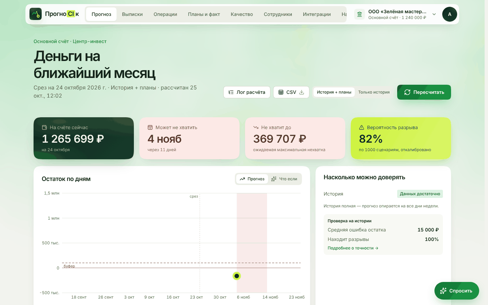
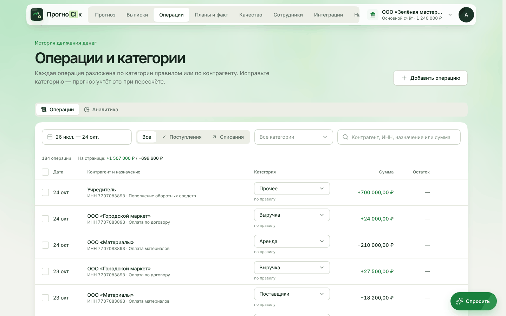
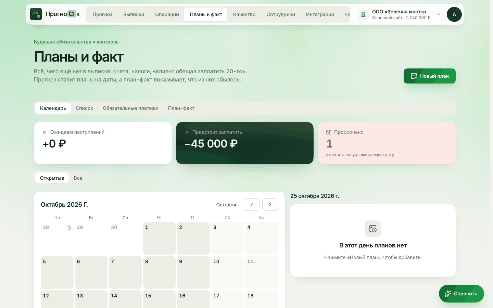
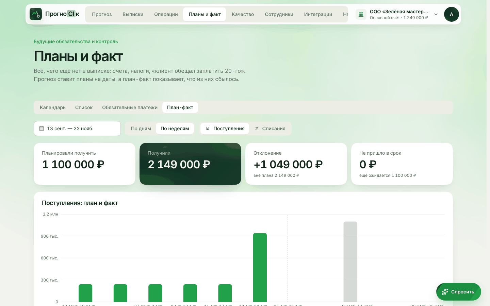
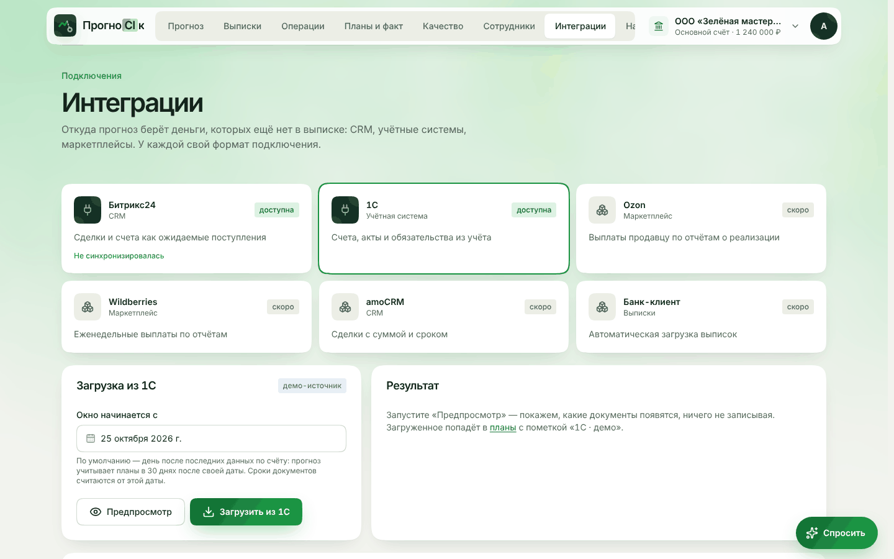
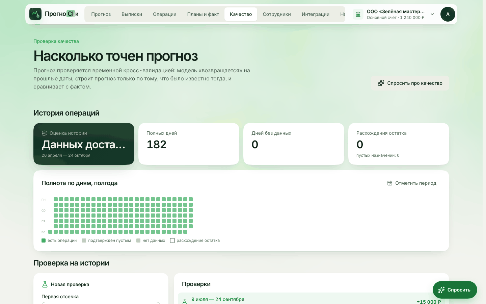
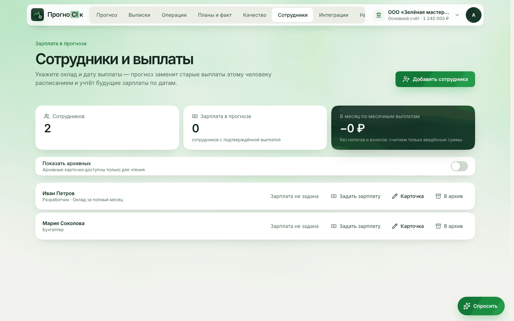
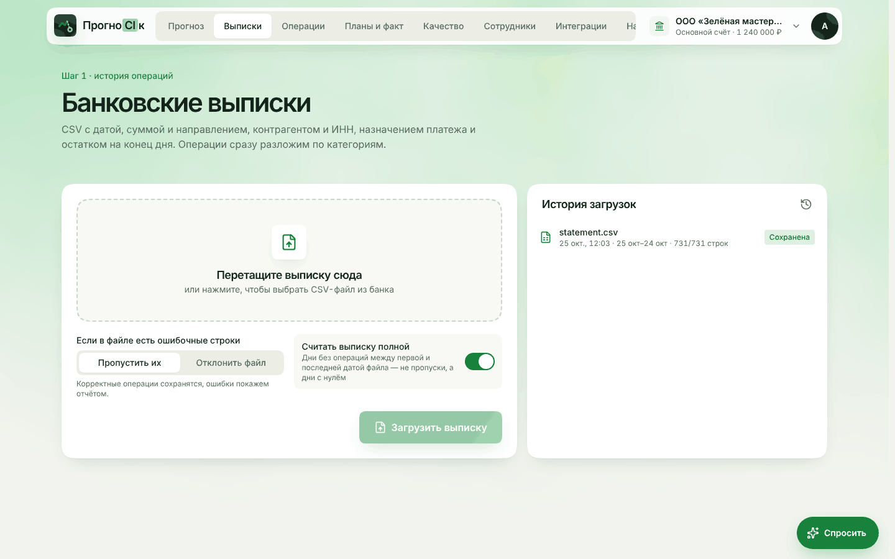
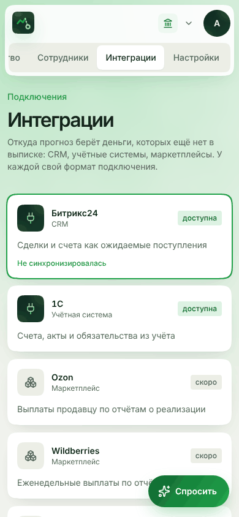
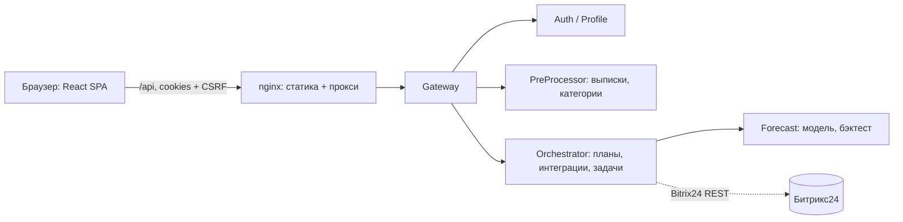

<div align="center">

# ПрогноCIк

**Сервис финансового прогнозирования для малого бизнеса** Хакатон «Осень 2026» · кейс Банка Центр-инвест

Прогноз остатка по дням · риск кассового разрыва · планы, налоги и счета · «что если» · план-факт · проверка качества
модели



</div>

---

## Что это

Предприниматель загружает выписки, а сервис отвечает на три вопроса: **когда** на счёте может не хватить денег, **какой
суммы** не хватит и **с какой вероятностью**. К истории добавляются то, чего ещё нет в выписке: выставленные счета,
налоги, сделки из CRM, зарплаты и обещания клиентов. Интерфейс рассчитан на человека без финансового образования: цифры,
цвета и подсказки на русском языке, без жаргона.

Этот репозиторий — **фронтенд**. Он работает с реальным API Gateway бэкенда (`hack-2026-back`), контракты сверены с
[`docs/FRONTEND_API_GUIDE.md`](docs/FRONTEND_API_GUIDE.md). Все расчёты прогноза, категоризации и качества делает
бэкенд, фронтенд показывает их результат и ничего не придумывает: неизвестное значение остаётся «нет данных», а не
нулём.

## Быстрый старт

### Через Docker (рекомендуется для сервера)

```bash
git clone https://github.com/Digital-Hustle/prognocik-frontend.git
cd prognocik-frontend

# Gateway на другом адресе (по умолчанию http://gateway:5001 внутри docker-сети)
GATEWAY_URL=https://api.example.com docker compose up -d --build
# → http://localhost:8080 (статика) · https://localhost:8443 (полный флоу входа)
```

Если бэкенд поднят из `hack-2026-back` (`compose.full.yaml`) на том же сервере, подключите фронт к его внутренней сети:

```bash
docker network ls | grep auth-edge          # узнать имя сети, обычно hack-2026-back_auth-edge
docker compose -f docker-compose.yml -f docker-compose.backend.yml up -d --build
# своя сеть: BACKEND_NETWORK=<имя> docker compose -f docker-compose.yml -f docker-compose.backend.yml up -d --build
```

Один контейнер, nginx без root, статика раздаётся с кэшированием, любой путь отдаёт `index.html` (SPA), а `/api/`
проксируется на Gateway. Браузер видит единый origin, поэтому HttpOnly-куки и CSRF работают без CORS.

| Переменная                       | По умолчанию          | Смысл                                                                                             |
| -------------------------------- | --------------------- | ------------------------------------------------------------------------------------------------- |
| `GATEWAY_URL`                    | `http://gateway:5001` | Куда nginx проксирует `/api/` (без слэша в конце и без пути)                                      |
| `FRONTEND_PORT`                  | `8080`                | HTTP-порт на хосте                                                                                |
| `FRONTEND_TLS_PORT`              | `8443`                | HTTPS-порт на хосте (локальный запуск; на проде за proxy можно не публиковать)                    |
| `DNS_RESOLVER`                   | `127.0.0.11`          | DNS, которым nginx разрешает `GATEWAY_URL` (встроенный DNS Docker)                                |
| `MAX_UPLOAD`                     | `110m`                | Максимальный размер загрузки (массовые операции — до 100 МБ по гайду)                             |
| `TLS_CERT_FILE` / `TLS_KEY_FILE` | путь в контейнере     | Сертификат для 8443; по умолчанию самоподписанный из образа. На проде подмените своими volume-ами |
| `VITE_API_URL`                   | пусто                 | Только при сборке: адрес Gateway, если он на другом origin (нужен CORS)                           |
| `VITE_SITE_URL`                  | пусто                 | Только при сборке: публичный HTTPS-адрес фронта для превью ссылок в Telegram                      |

> **HTTPS и полный вход.** Gateway выдаёт `Secure`/`HttpOnly`-куки, поэтому вход по email-коду и загрузка CSV работают
> только по HTTPS. Для локального запуска контейнер слушает `https://localhost:8443` с самоподписанным сертификатом
> (браузер попросит подтвердить исключение один раз). На сервере перед контейнером нужен reverse proxy с нормальным
> сертификатом (Caddy, nginx, Traefik). В `AUTH_ALLOWED_ORIGINS` бэкенда добавьте origin фронта
> (`https://localhost:8443` для локального запуска, публичный адрес — для прода), иначе Gateway отклонит изменяющие
> запросы по `Origin`.

Проверка состояния: `GET /healthz` → `ok` (он же используется как `HEALTHCHECK`).

### Локальная разработка

```bash
npm ci
cp .env.example .env.local   # VITE_GATEWAY_PROXY — адрес Gateway (по умолчанию https://localhost:5001)
npm run dev                  # http://localhost:3000, /api проксируется на Gateway
```

| Команда              | Что делает                                                                  |
| -------------------- | --------------------------------------------------------------------------- |
| `npm run build`      | `tsc -b` + продакшен-сборка в `dist/`                                       |
| `npm run check`      | typecheck + ESLint + проверка актуальности темы                             |
| `npm run test:demo`  | проверки демо-обработчика API                                               |
| `npm run fix`        | ESLint `--fix` + Prettier                                                   |
| `npm run fsd`        | линтер Feature-Sliced Design                                                |
| `npm run gen:tokens` | пересобрать `theme.css` и `docs/DESIGN.md` из `tokens.ts` (+ контраст WCAG) |

## Как показать за пять минут

1. **Вход.** Войдите по почте (код приходит письмом) и выберите организацию.
2. **Демо-показ.** На экране выбора организации — кнопка **«Демо»**: загрузите `companies.csv`, затем
   `all_operations.csv`, выберите организацию — вы окажетесь на прогнозе.
3. **Прогноз.** Остаток по дням, дата и сумма возможного разрыва, вероятность, лог расчёта и блок «Насколько можно
   доверять».
4. **Что если.** На графике переключатель «Что если»: задержка платежа, падение выручки, внеплановый расход.
5. **Планы и факт.** Календарь планов, налоговые сроки, кнопка «Новый план» («клиент обещал 300 000 ₽ 20-го»).
6. **Интеграции.** Битрикс24 (вебхук или демо-данные) и загрузка из 1С (демо-источник) — планы приходят с пометкой
   источника.
7. **Качество.** Бэктест: ошибка прогноза, доля найденных разрывов, сравнение моделей.

Отдельный **демонстрационный режим** включается в _Профиль → Дополнительно → Демонстрационные данные_. Бизнес-данные в
нём синтетические, но для входа и профиля нужен работающий Gateway. Скриншоты ниже сняты в этом режиме.

## Экраны

|                                               |                                                  |
| --------------------------------------------- | ------------------------------------------------ |
|   |              |
| **Операции и категории**, аналитика           | **Планы и факт**: календарь, налоги              |
|   |  |
| **План-факт**: отклонения по дням             | **Интеграции**: карточки источников              |
|               |         |
| **Загрузка из 1С**: предпросмотр и итог       | **Качество модели**: бэктест                     |
|  |           |
| **Сотрудники и зарплаты**                     | **Выписки**: загрузка CSV                        |

<p align="center">
  
  
  
</p>

Интерфейс адаптивный: работает на телефоне, диалоги открываются шторками снизу.

---

## Реализованные возможности

Реализован пользовательский путь от загрузки выписок до прогноза, проверки риска кассового разрыва, анализа качества и
работы с планами.

### Основные возможности

| #   | Требование                             | Где и как                                                                                                                                                                                                                            |
| --- | -------------------------------------- | ------------------------------------------------------------------------------------------------------------------------------------------------------------------------------------------------------------------------------------ |
| 1   | Разбор и категоризация операций        | **Операции → Операции**: у каждой операции категория и пометка «по правилу / по контрагенту / вручную». Категорию можно исправить, прогноз это учтёт. **Аналитика**: структура по категориям, поступления зелёным, списания красным. |
| 2   | Регулярные платежи, счета, налоги      | Блок **«Регулярные»** на странице «Прогноз»: поиск повторяющихся платежей, подтверждение каждого или всех. Счета и сделки — через планы и интеграции, налоги — налоговый календарь.                                                  |
| 3   | Прогноз остатка по дням на 30+ дней    | **Прогноз**: график остатка по дням, срез, зона неопределённости P10–P90, буфер, таблица по дням и экспорт CSV.                                                                                                                      |
| 4   | Риск разрыва: дата, сумма, вероятность | Четыре карточки сверху: остаток, дата возможного разрыва, сумма нехватки, вероятность. Если истории мало, вместо «—» показывается «Нет оценки» и причина.                                                                            |
| 5   | Понятный интерфейс для предпринимателя | Русские подписи без терминов, цветовые статусы, «Насколько можно доверять», чат-ассистент («Спросить»), подсказки в формах, мобильная версия.                                                                                        |

### Основа решения

| Требование                             | Реализация                                                                                                                             |
| -------------------------------------- | -------------------------------------------------------------------------------------------------------------------------------------- |
| Работающий прототип                    | Загрузка выписок (одной или массово) → прогноз по реальному Gateway. Демо-режим с синтетическими бизнес-данными; вход требует Gateway. |
| Модуль категоризации                   | Категории операций, ручная правка, массовая смена, аналитика по категориям.                                                            |
| Модель прогноза с проверкой качества   | **Качество**: бэктест на скользящих точках — средняя ошибка остатка, доля найденных разрывов, график факта и прогноза, выбор модели.   |
| График остатка и список предупреждений | График на «Прогнозе», панель предупреждений о разрывах с подтверждением («принято к сведению») и предупреждения расчёта.               |

### Дополнительные возможности

| #   | Требование                                  | Что есть                                                                                                                                                                                                                                                                                                                                                                                                                                          |
| --- | ------------------------------------------- | ------------------------------------------------------------------------------------------------------------------------------------------------------------------------------------------------------------------------------------------------------------------------------------------------------------------------------------------------------------------------------------------------------------------------------------------------- |
| ★1  | Договоры, счета, налоги как будущие события | **Счета**: планы с суммой, датой и сроком оплаты, номер и дата документа, привязка оплат. **Налоги**: налоговый календарь (НДС, НДФЛ, УСН) и кнопка «Создать план» на нужную дату. Все планы попадают в прогноз.                                                                                                                                                                                                                                  |
| ★2  | План-факт и автообновление                  | **Планы и факт → План-факт**: план и факт по дням, отклонения выделены, просроченные платежи помечаются. После изменения данных баннер «Прогноз устарел» и пересчёт одной кнопкой; риск проверяется заново.                                                                                                                                                                                                                                       |
| ★3  | Негативные сценарии «что если»              | Переключатель «Что если» на графике, расчёт на сервере (`POST …/scenarios/preview`). Рычаги: клиент заплатит на 2–4 недели позже, оплата не придёт, отложить наш платёж, падение выручки 10–30 %, рост расходов (регулярных или всех), внеплановый расход, разовое поступление. Базовая и негативная линии на одном графике, дата и сумма разрыва, вклад каждого рычага. Отдельно: «Сколько можно заплатить на дату» (`…/scenarios/max-payment`). |
| ★4  | Интеграции и ручной ввод                    | **Ручной ввод**: «Новый план» и «Добавить операцию». **Битрикс24**: сделки и счета как ожидаемые поступления (предпросмотр, синхронизация, вероятность сделки). **1С**: демо-источник, реестр из трёх документов. **Сотрудники**: зарплата как регулярный платёж. Источник данных виден бейджем.                                                                                                                                                  |

### Техническая реализация

| #   | Требование                           | Реализация                                                                                                                                                                                                                                                                                     |
| --- | ------------------------------------ | ---------------------------------------------------------------------------------------------------------------------------------------------------------------------------------------------------------------------------------------------------------------------------------------------- |
| 1   | Интеграции с внешними системами      | Битрикс24 (реальный вебхук), 1С (демо), CSV-импорт. См. ★4.                                                                                                                                                                                                                                    |
| 2   | Фоновые обновления прогноза          | Бэкенд помечает прогноз устаревшим (`STALE`), фронт показывает баннер и запускает пересчёт. Фоновые задачи опрашиваются, экран не блокируется.                                                                                                                                                 |
| 3   | Граничные случаи и пропуски в данных | Дни без данных — «нет данных», а не ноль. Подтверждение полноты выписки, подсказки при недостатке истории, предупреждения прогноза (`PLAN_OUTSIDE_HORIZON` и др.), валидация ИНН и КПП по алгоритму.                                                                                           |
| 4   | Сравнение подходов к прогнозированию | **Качество → Выбор модели**: бэктест сравнивает модели по точности и находит разрывы; выбранная модель и причины показаны.                                                                                                                                                                     |
| 5   | Схема архитектуры                    | Раздел «Архитектура» ниже (схема слоёв и потока данных).                                                                                                                                                                                                                                       |
| 6   | Тестирование                         | `npm run test:demo` — проверки бизнес-запросов, версионности, идемпотентности и пагинации; `npm run check` — типы, ESLint и контраст WCAG; `npm run fsd` — границы слоёв.                                                                                                                      |
| 7   | Безопасность                         | Токены только в HttpOnly-куки, CSRF на каждое изменение, `Idempotency-Key` и `If-Match`, без автоповтора изменяющих запросов. Секреты (вебхук Битрикс24) не хранятся и не логируются, финансовые данные не попадают в `localStorage`. nginx работает без root, с `read_only`, `cap_drop: ALL`. |

### Демонстрация решения

| Что просят                            | Чем подкрепляем в продукте                                                                                           |
| ------------------------------------- | -------------------------------------------------------------------------------------------------------------------- |
| Проблема, решение, цель               | Экран «Прогноз» отвечает на вопрос «Хватит ли денег на ближайший месяц».                                             |
| Демо на реалистичном сценарии         | Мастер **«Демо»**: загрузка организаций и операций из CSV → прогноз → разрыв → «что если» → план.                    |
| Источники данных                      | Выписки CSV, ручные операции и планы, Битрикс24, 1С (демо), налоговый календарь, сотрудники. Источник виден бейджем. |
| Подход к прогнозу и проверка качества | Страница «Качество»: бэктест, ошибка, доля найденных разрывов, сравнение моделей, лог расчёта.                       |
| Архитектура                           | Раздел «Архитектура» ниже.                                                                                           |
| Дополнительные возможности            | Планы и счета, налоговый календарь, сценарии «что если», план-факт, интеграции и сотрудники.                         |

### Наши собственные фичи (сверх кейса)

- **Чат-ассистент** («Спросить»): отвечает по данным организации и подсказывает, куда нажать.
- **Лог расчёта**: пошаговый разбор, из чего сложился прогноз.
- **Тепловая карта истории** и подтверждение полноты данных по периодам.
- **Массовая загрузка** организаций и операций (демо-показ): тысячи компаний с поиском.
- **Календарь платежей** и налоговый календарь рядом с планами.
- **Сотрудники и зарплаты**: зарплата превращается в регулярный платёж, ИНН проверяется по контрольной сумме.
- **Редактирование организаций**: форма с валидацией ИНН/КПП под форму собственности.
- **Экспорт** прогноза в CSV, **цветовая аналитика** расходов и доходов.
- **Мобильная версия** и тёмная тема (по настройке системы), массовая смена категорий выделенных операций.

---

## Архитектура



Фронтенд построен по **Feature-Sliced Design**: слайсы в PascalCase, `index.ts` — публичный API, границы слоёв проверяет
`eslint-plugin-boundaries`. Серверные данные — RTK Query (`rtkApi.injectEndpoints`).

```
src/
├─ app/        провайдеры (Store, Router с guard'ами, ErrorBoundary, DemoProvider), стили и тема
├─ pages/      Forecast, Import, Operations, Plans, Quality, Employees, Integrations, Settings, Profile, Onboarding, DemoImport, Auth
├─ widgets/    Navbar, ForecastChart, ForecastOverview, AlertsPanel, RecurringPanel, PlansCalendar, PlanFactPanel, TaxCalendar,
│              PaymentCalendar, PaymentsTable, SpendingAnalytics, BacktestReport, HistoryHeatmap, BitrixIntegration, OneCIntegration …
├─ features/   AuthByEmail, UploadStatement, BulkImport, ChangePaymentCategory, DetectRecurring, EditExpectedPayment, RunForecast,
│              RunBacktest, WhatIfScenario, SyncBitrix24, SyncOneC, ManageEmployees, AskAssistant, ConfirmCompleteness …
├─ entities/   Company, Payment, Forecast, Backtest, ExpectedPayment, Recurring, PlanFact, Employee, Bitrix24, OneC, TaxCalendar …
└─ shared/     api (клиент Gateway), config (токены, анимации), ui-кит, lib (валидаторы ИНН/КПП, даты, деньги)
```

### Работа с Gateway (`shared/api`)

- Токены — HttpOnly-куки, `credentials: "include"`; в `localStorage` только настройки интерфейса и выбранный счёт.
- `X-CSRF-Token` из `GET /auth/csrf` на все изменяющие запросы; при `CSRF_INVALID` — новый токен и один повтор.
- `401` на GET → один `refresh` и один повтор чтения; изменяющие запросы автоматически не повторяются.
- `Idempotency-Key`: новый UUID на операцию, тот же — при повторе с тем же телом.
- `If-Match: "<version>"` на редактирование; при `409` данные перечитываются.
- Ошибки `application/problem+json`: ветвление по `code`, пользователю показывается понятный текст.
- Фоновые расчёты (прогноз, бэктест, поиск регулярностей): `POST …-jobs` → опрос `GET /jobs/{id}` → обновление данных.

### Честность данных в интерфейсе

- День без данных — «нет данных», а не ноль; линия факта рвётся.
- Вероятность `null` — «нет оценки», не 0 %. Причина показывается рядом (мало истории, неполные данные).
- Факт и прогноз — разные серии, граница — дата среза; зона P10–P90 рисуется отдельно от точечного прогноза.
- Устаревший прогноз остаётся на экране с пометкой, новый расчёт идёт отдельно.
- «Что если» — расчёт сервера поверх готового прогноза: отдельная линия сценария, дата и сумма разрыва, вклад каждого
  изменения.

## Демонстрационный режим

Включается в **Профиль → Дополнительно → Демонстрационные данные**. Перехватываются запросы `/api/v1/orchestrator/**` и
`/api/v1/preprocessor/**`; вход и профиль всегда работают с реальным Gateway. Демонстрационные компании, операции,
планы, прогнозы и бэктесты согласованы между собой; действия меняют только память вкладки. Финансовые данные в
`localStorage` не записываются. `npm run test:demo` проверяет этот обработчик.

## Стек

React 19 · TypeScript strict · Vite 8 · Redux Toolkit + RTK Query · React Router 7 · Tailwind 4 · motion · recharts ·
ogl (WebGL-фон) · lucide · nginx (прод).

## Дизайн

Цвета — со слайдов кейса Центр-инвеста: «лесной» `#0F2A20`, фирменный зелёный `#21A24A`, лайм `#CDF23A`, «бумага»
`#F2F3EE`. Шрифты Unbounded (заголовки, суммы) и Onest (интерфейс). Подробно — [`docs/DESIGN.md`](docs/DESIGN.md).

## Для разработчиков

Правила проекта — [`AGENTS.md`](AGENTS.md). Перед коммитом: `npm run check && npm run test:demo && npm run fsd`.
